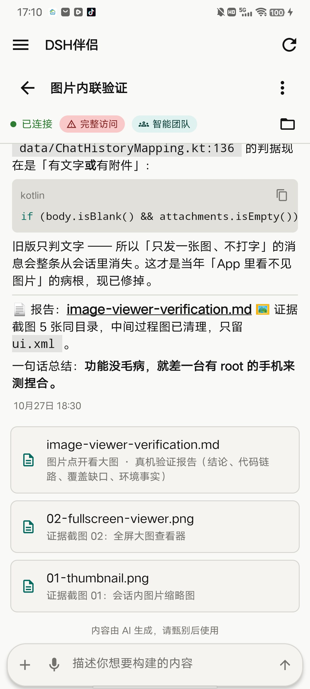
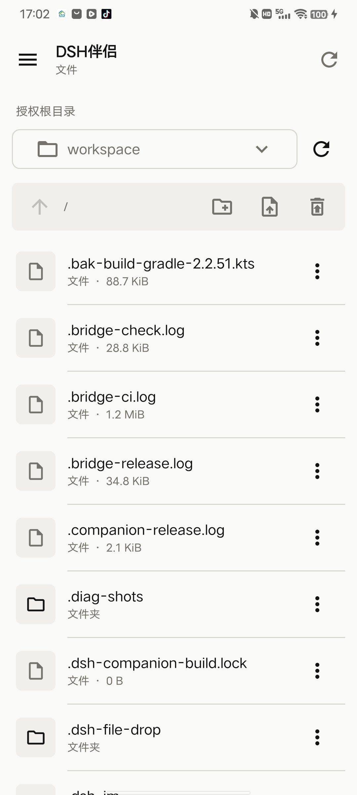
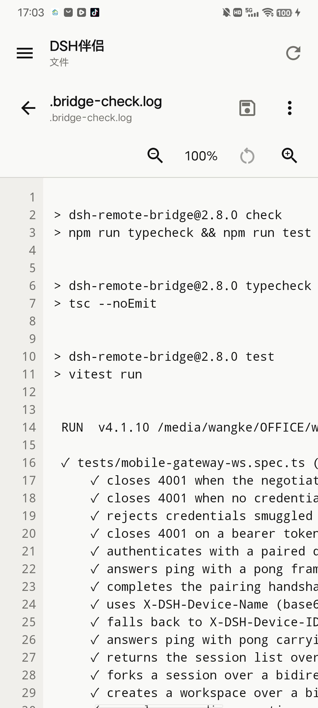
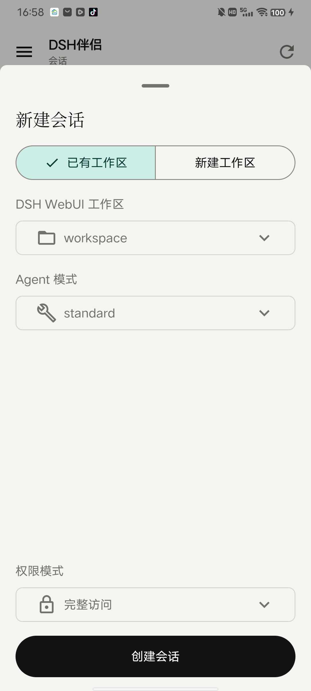
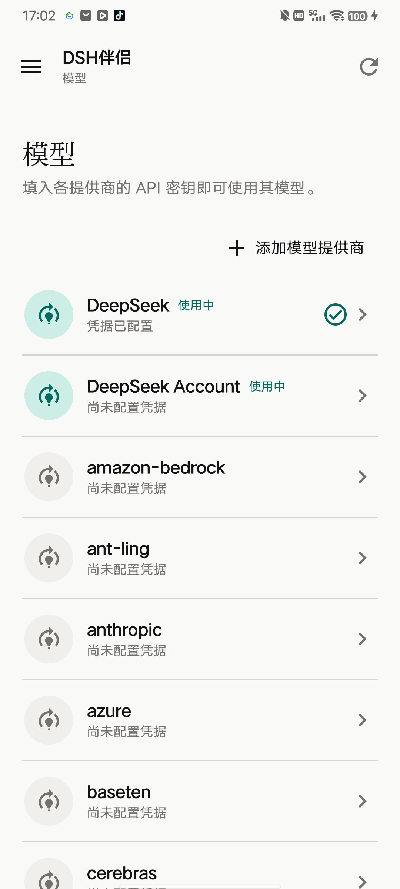

# dsh-companion

<p align="center">
  <strong>把你自己的 DeepSeek Harness 带到 Android 手机上。</strong>
</p>

<p align="center">
  中文 · <a href="./README.en.md">English</a>
</p>

<p align="center">
  
  
  
  
</p>

## 关于本仓库

本仓库是 [Hakunm/dsh-android-app](https://github.com/Hakunm/dsh-android-app) 的**衍生版本（fork）**，
在上游 `v1.0.0` 的基础上继续开发。它保留上游的完整提交历史，因此归属关系可逐条追溯。

- **基于什么**：上游 [Hakunm/dsh-android-app](https://github.com/Hakunm/dsh-android-app)（Android 原生客户端，Jetpack Compose + Material 3）。
- **为什么有它**：上游的连接模型只支持「一台电脑 = 一个地址」，在真实移动场景下不够用。具体见下一节。
- **许可证**：上游以 **AGPL-3.0** 发布，本仓库沿用同一许可证，见 [LICENSE](./LICENSE)。
  上游的版权声明、[NOTICE](./NOTICE) 与 [THIRD_PARTY_LICENSES](./THIRD_PARTY_LICENSES) 全部保留未改动。
- **我们改了什么、为什么、测了什么**：见 [开发日志](./docs/project/CHANGELOG-DEV.md)。

## 这个版本解决什么问题

手机端日常使用暴露出四个问题，它们看起来互不相干，实际上指向**同一个根因**：
旧实现把「一台电脑」和「一个地址」当成了同一个东西。它的数据模型只有：

```kotlin
data class StoredConnection(val endpoint: String, val token: String)
class DshClient(endpoint: String, token: String?)
```

`endpoint` 是**单个字符串**。于是：

| 实际遇到的问题 | 真正的根因 |
|---|---|
| 只能添加一条路径 | 模型里只有一个 `endpoint: String`，装不下第二个地址 |
| 出门在外没法配对 | 配对码必须在电脑上生成，而那时人已经不在电脑旁 |
| 局域网 / 虚拟网 / 公网不能同时保存 | 同上：只有一个地址位 |
| 会话里提到的文件看不了 | 会话事件中的绝对路径没有与授权根做匹配 |

### 关于「出门在外」这个场景

这一条值得单独说，因为它推翻了上游的一个前提。上游的连接方式是**一次性配对码**：
在电脑的 WebUI 上生成，拿到手机上输入。这个流程默认「人和电脑在一起」。

但真实场景恰恰相反：**人已经出门了，电脑留在家里，屏幕根本看不到**。此时
「去电脑上生成一个配对码」不是难用，而是**做不到**。扫码同理 —— 对着看不到的屏幕扫不了。

所以本版本把「配置导入」作为主路径：

```
电脑上生成一行文本 → 发给自己（微信 / 邮件 / 私密笔记）→ 到了外面粘贴进 App
```

全程不需要电脑在旁边，也不需要摄像头。配对码被保留为**次要入口**（你正坐在电脑前时它更快），
并在界面上明确标注了这个前提条件。

## 本仓库相对上游的改动

### 1. 一台电脑，多个地址

连接层重新建模（`app/src/main/java/io/github/westanke/dshcompanion/data/ConnectionModels.kt`，v2.2.41 前为 `io/github/hakunm/deepseekharness/…`）：

```
Host        一台电脑：名字、凭据、若干地址、上次成功用的地址
 ├─ Endpoint   一个可达地址：标签、baseUrl、类型（局域网/虚拟网/公网）、探活历史
 └─ Credential 凭据：挂在电脑上，而不是挂在地址上
```

**关键点：这个改动不需要服务端做任何修改。** DSH 的 `devices` 表结构是
`id, name, token_hash, scopes_json, created_at, last_seen_at, revoked_at` ——
**根本没有地址列**。设备令牌天然是主机级的，同一个令牌在任何地址上都有效。
也就是说「多地址」一直是客户端本来就能做到、只是过去没做的事。

启动时的行为：并发探测这台电脑的**全部**地址（每个地址独立超时，实测 1.5 秒），
按「延迟优先、局域网近似即优先」选路，失败自动回退到下一个可达地址。
另外，**启动永远先落在连接页**：自动重连成功也不会直接进应用，要由用户的一个主动动作放行
（点「进入应用」/ 导入配置 / 配对）。

### 2. 配置导入取代扫码

`ConnectionShare.kt` 定义了线格式 `DSH1:<Base64URL(JSON)>`，解码端对真实粘贴环境做了容错：
微信插入的换行与零宽字符、前后带标签文字（`Pixel 9 的配置：DSH1:xxx`）、缺失的 `=` 填充、
标准与 URL-safe 两种 Base64 字母表、结尾被粘上的标点 —— 全部能正确还原。

生成端是 `tools/emit-config.mjs`。

### 3. 地址诊断

全部地址都连不上时，不再只说一句「连接失败」，而是逐条列出每个地址的结果：

```
局域网    192.168.1.126:3090   Unreachable — timeout after 1500ms
虚拟网    100.64.250.1:3090    Reachable · 38 ms
```

过去用户只能靠猜「我该填哪个地址」，现在他看得到。

### 4. 断开不再清除凭据

上游把「断开连接」和「删除令牌」绑成同一个按钮。于是网络抖一下、手点错一次，
用户就得重新配对 —— 而重新配对又要求他人在电脑旁。
现在断开只断连（`disconnect`），删除电脑是独立动作（`removeHost`）。

### 5. 旧数据自动迁移

从旧版升级时，已保存的地址与设备令牌会自动迁移成新的 `Host` 结构，无需重新配对。
迁移是幂等的，且**旧格式的令牌会用旧的 Keystore 别名解密**后搬过来。

### 6. 插件清单页

手机上多了一个「插件」页签，能看到这台机器装了哪些插件、**实际跑的是哪个版本**、以及有没有异常状态。

这一条**必须动服务端**：`dsh-remote-bridge`（当时名为 `dsh-workspace`）的 `/api/v1` 原有 10 个端点
（`healthz` / `pairings/exchange` / `devices/self` / `roots` / `trash` / `chat/sessions` /
`chat/workspaces` / `chat/agent-presets` / `settings/models` / `settings/providers`），
**没有任何一个与插件相关**，所以先在插件侧加了 `GET /api/v1/settings/plugins`。

它区分四种状态，其中两种只有对比两个数据源才能得出（`package.json` 的 `dependencies` =
装了哪些包，`dsh.profile.bundles` = 实际加载了哪些包）：

| 状态 | 含义 |
|---|---|
| `loaded` | 声明加载且已落盘 |
| `runtime-provided` | 官方包随 DSH 运行时自带（不在 profile 的 `node_modules` 里）—— **正常状态** |
| `installed-not-loaded` | 装了但没启用 |
| `declared-missing` | 非官方包声明加载却缺失，通常意味着启动会出问题 |

「装了哪些」与「跑着哪些」的差别正是它的价值所在 —— 例如本机实测发现
`dsh-hyperframes` 与 `dsh-remotion` 装了但未启用。

> **DSH 0.2.x 兼容性**：本分支同样包含上游修复的枚举契约问题 —— 0.2.x 的 `AgentPreset`
> 不再返回 `trust` 字段，而客户端严格解码要求该字段必填，导致 Agent 预设选择器报
> `Field 'trust' is required ... missing at path: $.items[0]` 并整体打不开。
> 修复方式是给可选字段补默认值，使**单个字段缺失不再拖垮整个列表**。
>
> **三方版本对照（2026-10-20 补）**：本 App 通过 `dsh-remote-bridge`（≥ 2.4.1）间接使用 DSH 内核，
> **不直接连内核**。已核对的组合是「App v2.2.46 ↔ bridge 2.4.3 ↔ DSH 0.2.0-rc.2 / 0.2.1-rc.2」——
> bridge 的 10 项宿主服务 `inject` 在 0.2.1-rc.2 上全部仍存在且签名未变（详见
> `dsh-remote-bridge/docs/project/DSH-0.2.1-ADAPTATION.md`）。内核 0.2.1 新增的
> `session/working-directory/{get,set}` 属 **SDK profile** 能力，bridge 侧尚未透出，故本 App
> 对会话工作目录仍为**只读**（可显示、可作 `@` 补全基准，不可在会话内切换）。

### 7. 运行时的发送行为可配置：排队 / 插话（v1.3.0）

运行中按发送键之后会发生什么，此前是写死的。现在设置页有一组单选项，并且运行中会在发送键旁
显示当前默认（`回车=排队` / `回车=插话`），不必回设置页确认。

同一版还修掉了一个更要命的问题：**智能体运行时根本发不出消息**。旧实现用一个全局 `busy`
标志禁用发送键，而这个标志会被**任何一次后台刷新**置位 —— 于是「运行中不能发」实际变成了
「随时不能发」。会话中提到的文件也在这一版可以直接打开。

### 8. 会话图片可见 + 消息可复制 + 链接可点 + 发图 / 发文件（v1.4.0）

「会话里的图片看不见」是**两个问题叠加**，只修任何一个都不生效：

1. 只发图、不打字的消息被判成**空消息**，整条丢弃；
2. 历史图片在事件里只是一个 `attachmentId` **引用**，字节需要另发一次请求去取。

此外消息可以复制、链接可以点、输入区可以发图片和文件（图片内联 base64，文件先换取 receipt）。
附件体积在**发送前**拦截（图片 8 MiB / 文件 24 MiB），给的是能照做的动作（「先压缩再试」），
而不是一句「文件过大」。

### 9. dsh-ui 交互卡片原生渲染（v1.5.0）

`dsh-ui` 围栏里的 JSON 在网页版会渲染成真正的组件。App 原来把围栏当代码块画，用户看到的是一坨
**裸 JSON** —— 最直接的后果是**助手在网页版弹给用户的选择题，手机上没法回答**。

现在 22 种组件（卡片 / 表格 / 列表 / 按钮 / 选项 / 进度 / 时间线 …）原生渲染，卡片里的选择按钮
等价于用户打字发送，走同一条消息通道。

### 10. 会话产生的文件列在消息流末尾（v1.6.0）

对齐网页版形态：本轮回复结束后，会话产生的文件自动列在消息流末尾（显示条数、可折叠、点开看内容）。
顶栏的文件夹图标**保留**，两者不冲突。

刻意**不**解析 `bash` 命令里的路径 —— 那里面大多是搜索范围、变量或 `echo` 出来的文本，
**误报比少列更糟**（点一个打不开的路径，用户会以为功能坏了）。

### 11. dsh-ui 诊断开关（v1.7.0）

设置页「调试」组新增一个开关（默认关）。打开后每条助手消息下方显示一行灰字，说明这张卡片为什么
没渲染：**围栏识别 → JSON 解析 → 节点分发**三段各报一次结果，点击展开、长按复制。

「围栏没识别」「JSON 坏了」「节点类型不认识」这三种故障原本在屏幕上长得一模一样，
在没有可用设备的环境里只能靠猜。

### 12. 发送失败不吞字 + 取图失败说清原因（v1.8.0）

- **发送失败不再吞字**：原文自动放回输入框。此前失败只还回附件，文字直接丢 ——
  打了一长串字、发送失败、输入框空了，一个字都找不回来。
- **取图失败显示真实原因**：401 授权过期 / 403 缺 `files.read` / 404 附件真没了分开提示，
  不再一律显示「图片已不可用（可能已被清理）」。授权类失败还允许重试 ——
  此前失败一次就永久记住，重新配对也不能自愈。

### 13. 长按选中片段 + 文件按类型预览（v1.9.0）

**手势分工**：长按留给「选中片段」，整条复制改用**双击**。此前长按被「复制整条」消费掉，
内层选择手柄根本弹不出来，用户只能整段复制。消息流顶部有一次性的可关闭提示说明这个改动。

**文件预览按类型分流**：`.md` 走 Markdown 渲染，`.html` 走结构化抽取
（标题 / 段落 / 列表 / 引用 / 代码 / 链接，**丢弃 `script` 与 `style`**）。
刻意**不用 WebView** —— 那等于让会话里出现的任意文件在手机上拿到执行权。

### 14. 2.0–2.2 版本线：WebView 聊天页，以及与原生对齐

2.0.0 起，会话详情页多了一条 **WebView 实现**（`assets/chat.html`，把 Markdown 与卡片渲染交给浏览器），
与原生 Compose 版并存、由设置里的「聊天页实现」开关切换（**默认仍走原生** —— 原生版是走过真机验证的资产）。
2.2.15 起，把网页版那套呈现方式反向移植回原生。这条线到 2.2.20 的主要变化：

- **连接页是入口，不是兜底**：启动永远先落连接页（进程级门闩 `connectGate`，只由用户的主动动作放行）；
  冷启动自动重连成功也仍然停在连接页。**导入配置**与**手动配对**两种方式默认都收起、点哪个开哪个，
  且互斥展开 —— 屏幕上不会同时铺两份表单。
- **输入区照网页版重做**：药丸压成一行（`+` · 输入框 · 发送），模型 / 智能体 / 权限模式 / 插话收进顶栏
  `⋯` 菜单，附件并入 `+`；**输入框高度随内容自适应**（44–120dp；此前写死 34dp，敲到第二行就被裁）。
- **思考条在输入区上方一行**：流式期间只显示「当前思考」，取尾部、过长省略号截断；没有思考时整条不渲染
  （不占高度）。历史里的思考过程不再显示。
- **工具显示改官方口径的动作短语**（「运行了代码，修改了文件」），且**连续的工具调用合并成一行**；
  此前一次调用一行，跑几十次就是一屏。
- **上下文注入默认隐藏**：系统每轮塞进来的运行上下文 / 时间上下文 / 后台任务通知默认不显示，
  需要排查时在设置里打开。
- **模型供应商配置独立成「模型」页**（导航里的「模型」），不再是设置页里的一块；设置页因此从 697 行瘦到 297 行。
- **设置页开关统一形态、点一下立刻生效**：三个开关（用网页版聊天页 / 显示上下文注入 / dsh-ui 卡片诊断）
  统一走同一套 `SwitchRow`，状态进 `HarnessState`。此前直接读 `SharedPreferences`，那不是 Compose
  状态，于是表现为「点了开关不动、得再点别的才跳」。
- **会话交付物直读内核事件**：会话底部与标题栏的文件夹弹层都改读内核的 `deliverables/presented`
  （`present` 工具触发，带绝对路径与人写的说明）。此前只认三种会话事件，agent 交付的报告与安装包
  整类看不到；两处共用同一个 `sessionFileList()`，不会再出现「底部是交付物、弹层是一堆嗅出来的路径」。

这一段的逐版取舍与踩坑记录在 `app/build.gradle.kts` 的版本注释与 `docs/project/CHANGELOG-DEV.md`；
「移植未实现项」清单在 `docs/project/webview-port-todo.md`。

### 15. 对标补强：会话页舒适度、文件卡片与可靠性（v2.2.42 起）

> 这一批改动已随 v2.2.42 发布。以下是用户能感知的部分。

- **消息更好读**：代码块带语言标签、复制键与高亮；思考 / 工具 / 上下文折叠成一组并显示**耗时摘要**；
  消息下方有时间戳（今天只给时刻，更早给日期）。长按选词不受影响 —— 新入口刻意不占长按。
- **图片能点开看、能存相册**；会话文件面板里的文件能下载。
- **失败可以重试**：出错那行旁边多一个「重试」按钮（登出停止这类重试无意义的失败不显示它）。
- **能从某条消息分叉**：用户消息下方有「从这条分叉」，会新建会话并切过去（有二次确认）。
- **已归档的会话能看了**：会话面板可切到「已归档」。**恢复归档暂不支持** —— 需在电脑端 WebUI 调整：
  内核是否提供取消归档的接口，从客户端侧无法确认，所以我们不做一个可能不存在的按钮。
- **文件卡片是实时的**：智能体明确交付的文件会**立刻**出现在会话文件面板，不必等下一轮消息。
- **会话统计与轨迹**（顶栏 `⋯` 菜单新增两项）：「会话统计」给出轮次 / 助手消息 / 工具调用 /
  事件总数 / 数据截至；「轨迹」按轮次排成时间轴，**点节点可看当时收到的原始事件 JSON** ——
  排查「这一步为什么慢、它到底调了什么」用。
  **Token 用量与上下文压力不显示**：内核没有提供 usage 数据，我们也**不会用字符数估算冒充它**
  （估算误差成倍，会误导你对余量的判断）。
- **外观可调**：设置页可选界面样式，并能单独调字号（也可跟随系统）。
- **两个「感觉不到但更可靠」的改动**：切换会话时不再出现「闪一下又跳回来」（旧请求的结果不再覆盖新会话）；
  网络重连后审批与提问卡片仍会到，服务端也补齐了「新连接一定拿到仍待处理交互」的保证。
- 这一批**同时需要服务端插件配合**（姊妹仓 `dsh-remote-bridge` 有对应改动：能力位、订阅基线、
  断档检测、交互重放、文件卡片事件）。两仓的版本以各自 `CHANGELOG-DEV.md` 为准。

## 构建

```bash
scripts/build.sh                      # 默认 assembleDebug
scripts/build.sh assembleRelease      # 发布包
scripts/build.sh :app:testDebugUnitTest   # 单元测试
```

`scripts/build.sh` 的存在是有原因的，不是多余的包装：

1. **绕开 Gradle wrapper 的静默挂起。** `gradle-wrapper.properties` 里的
   `distributionUrl` 指向 `services.gradle.org`，该地址在国内网络下不可达，而 wrapper
   下载失败时**不报错退出，而是挂起**（实测：CPU 0.3%、零网络连接、无 daemon 日志，十几分钟无输出）。
   脚本直接调用本地已缓存的 Gradle 二进制。
2. **依赖镜像。** 本机无法访问 `maven.google.com`，需要经阿里云镜像重定向。
   注意用的是**本项目自带**的 `scripts/init-mirrors.gradle`：工具链里那份会往 project 级
   仓库追加，与本项目 `settings.gradle.kts` 的 `RepositoriesMode.FAIL_ON_PROJECT_REPOS`
   冲突并直接构建失败。
3. **串行化。** Gradle 对同一项目目录是互斥的，脚本用 `flock` 保证并发调用不会互相抢锁。

## 下载与安装

从 Releases 下载。**Gitee 是主站（首发在这）**，AtomGit 为国内备站（仅代码镜像），
GitHub 是自动同步的镜像从站（每 3 小时从 Gitee 同步，Release 可能略有延迟）：

- Gitee（推荐，国内最快）：<https://gitee.com/westanke/dsh-companion/releases/latest>
- GitHub（镜像）：<https://github.com/westanke/dsh-companion/releases/latest>
- AtomGit（代码备站，无 Release 资产）：<https://atomgit.com/westanke163/dsh-companion>

```text
DSH伴侣-companion-v2.2.57.apk
```

安装要求：

- Android 8.0（API 26）或更高版本
- 已运行的 DeepSeek Harness WebUI
- DSH WebUI 已安装 `dsh-remote-bridge` **≥ 2.3.7**（旧名 `dsh-workspace`；2.0.0 / 2.0.1 有严重缺陷：
  图片读取全部失败、插件无法激活；**审批 / 问答卡片需要 2.3.7+**，更低版本在手机端一张都不显示。
  **断档自动重同步、订阅基线、交付物实时卡片、`seq` 单一语义需要 2.3.8+** —— 缺了不报错，只是少这几样）
- 插件中至少添加了一个授权根，并已启用远程访问
- 手机可以访问插件配置的 IP、域名和端口

**签名现状（重要）：`v2.2.25` 起使用重新生成的正式证书（`CN=DSH Pocket Client`，主题与旧证书一致）。**
项目原来那把发布证书的**密码已丢失**（本机 / 仓库 / CI / 记忆库全查过），所以现在这把是重新生成的：
主题刻意保持一致，但它**不是旧钥匙**。几个直接后果：

- **`v1.9.0` 及更早的包盖不上**：签名不同，必须先卸载再装（卸载会清除已保存的连接，
  装好后重新配对，或直接粘贴一份配置文本）。
- **`v2.2.25` 及以后可以互相覆盖升级**（同一把证书）。
- **⚠️ `v2.2.41` 起包名变了**（`io.github.hakunm.deepseekharness` → `io.github.westanke.dshcompanion`）：
  应用名同步改为「DSH伴侣」，规避「DeepSeek」商标风险。**`applicationId` 变了就是另一个 App**，
  `v2.2.40` 及更早的包**无法覆盖安装，必须先卸载**（同样会清空已保存的连接，需重新配对）。
  理由与影响详见 [开发日志 v2.2.41](./docs/project/CHANGELOG-DEV.md)。
- 与上游原版（`CN=Hakunm`）的证书同样不同，从上游版本切过来也要先卸载。

发布历史：`v1.1.0` / `v1.2.0` / `v1.4.0` / `v1.9.0` 各有独立 tag；`v1.5.0`–`v1.8.0` 没有单独打 tag，
这四个版本的功能随 `v1.9.0` 一并发布。`v2.0.0`–`v2.2.19` 之间没有 tag；`v2.2.20` 起各版本 tag 均同步
Gitee / AtomGit / GitHub 三端（GitHub 为自动镜像），产物见 Releases 页。

## 界面预览

<!-- 导航侧栏截图已移除：v1.2.0 起抽屉内多出「插件」入口，底部还多了当前地址，
     旧图与实际不符；本机无 Android 设备可重录，宁缺毋滥。 -->
<p align="center">
  
  
</p>
<p align="center">
  
  
</p>
<p align="center">
  
</p>

## 连接你的 DSH

### 服务器端

1. 在 DSH WebUI 打开 `dsh-remote-bridge`（旧名 `dsh-workspace`）的“工作区设置”。
2. 添加至少一个授权根目录。
3. 在“远程访问”页填写绑定 IP 和端口，并保存监听设置。
4. 点击“启用并创建配对”，取得十分钟内有效的一次性配对码。

### 手机端

打开 App 会先落在**连接页**，上面有已保存的电脑，以及两个默认**收起**的入口（点哪个展开哪个，一次只开一个）：

1. **从电脑导入配置**（主路径）：把配置文本粘贴进来即可 —— 人已经出门、看不到电脑屏幕时，只有这条走得通。
2. **手动配对**：填服务器地址（例如 `http://192.168.1.20:3090` 或 `https://dsh.example.com`）、配对码和设备名称，
   再点“配对并连接”。人正坐在电脑前时它更快。

> **地址格式：千万不要带 `/dsh-workspace-api` 前缀。**
> 这一点很容易搞错，而且错了必然连不上。实测：
>
> | 请求 | 结果 |
> |---|---|
> | `http://192.168.1.126:3090/api/v1/healthz` | 200 ✅ |
> | `http://192.168.1.126:3090/dsh-workspace-api/api/v1/healthz` | 401 ❌ |
> | `http://127.0.0.1:3080/dsh-workspace-api/api/v1/healthz` | 200（但只绑 loopback，手机到不了） |
>
> 原因：`3090` 是**插件的远程监听端口**，路由直接挂在根上、**不带前缀**；而
> `/dsh-workspace-api` 是 DSH Web 在 `3080` 上的挂载面，只绑 `127.0.0.1`。
> 客户端 `DshClient.normalizeEndpoint()` 会自动补 `/api/v1`，所以如果你填了
> `http://ip:3090/dsh-workspace-api`，实际会请求 `/dsh-workspace-api/api/v1/...`，
> 而该路由在 3090 上并不存在。
>
> 插件虽然已经改名 `dsh-remote-bridge`，但 Web 挂载前缀仍是历史名 `/dsh-workspace-api`
> （插件源码里硬编码，没有跟着改）—— 这不是笔误，也别写成 `/dsh-remote-bridge-api`。

设备令牌由 Android Keystore 支持的加密存储保存。App 重启后会恢复连接。

> **令牌不会自动过期。** 服务端的 `devices` 表没有过期列，所以一段配置文本一旦发出就长期有效，
> 只能通过吊销设备使其失效。因此：配置文本只发给自己，一旦怀疑泄露，请立刻在电脑上吊销对应设备
> （`curl -X DELETE http://127.0.0.1:3090/manage/devices/<id>`），而不是指望它“看不懂”。

## 聊天不只是收发消息

- 查看设备有权访问的 DSH 会话和实时运行状态。
- 以流式增量显示助手正文；思考显示在输入区上方那一行，结束后与服务器历史校准。
- 正确排版 Markdown 标题、列表、引用、代码块和表格。
- 工具调用显示成动作短语（「运行了代码，修改了文件」），连续的一串合并成一行、点开看每次调用。
- 原生渲染助手的 `dsh-ui` 交互卡片（卡片 / 表格 / 列表 / 按钮 / 选项 / 进度 / 时间线 …），
  卡片里的选项点一下等于把它发送出去。
- 发送普通消息，在运行中追加引导（插话），或取消当前任务。
- 发送图片和文件（输入区 `+` 菜单）；运行中的发送行为（排队 / 插话）在 `⋯` 菜单或设置页选。
- 查看 DSH TODO 模块、完成进度和正在处理的事项。
- 输入 `/` 浏览并执行服务器提供的 host 斜杠命令；**不是命令的 `/技能名` 按官方语义原样发给模型**，
  由 Host 注入技能正文（早先版本把任何 `/` 开头都当命令，技能因此一个都调不动）。
- **回答 agent 的提问**：它中途问你时卡片直接出现 —— 题干、补充说明、每个选项的说明分开显示，
  `multiSelect` 决定单选还是多选，没有选项时给自由文本输入。答完卡片转「已回答」。
  电脑端官方界面同时也能答，**先答者胜**。需要电脑端插件 `dsh-remote-bridge ≥ 2.2.2`。
- 在 `⋯` 菜单切换「只读」「工作区写入」「完整访问」。完整访问会再次提示风险。
- 查看待审批工具调用的脱敏信息，选择「允许一次」或「拒绝」。
- **展开工具调用看细节**：完整输入、输出、成败与耗时。手机上开不了终端，这是事后排查的唯一手段。
- **预览图片与 PDF**（文件页与会话附件都支持）：双指缩放、拖动，PDF 可逐页翻。
- 在 `⋯` 菜单切换模型和思考强度。空白会话还可以在首条消息前选择 Agent。
- 输入框高度随内容自适应（44–120dp，一行到六行左右）。
- 双击复制整条消息，长按选中片段，点开链接。
- agent 交付的文件（`present` 工具）列在消息流末尾，点开即看；标题栏的文件夹按钮列出同一份清单。

## 工作区与会话

新建会话时，可以选择 DSH WebUI 已登记的工作区，也可以从设备获准访问的根目录中挑选一个现有目录，将它登记为新的 DSH 工作区。

工作区管理支持：

- 查看设备可访问的 DSH 工作区。
- 重命名工作区。
- 移除工作区登记。

移除登记不会删除服务器目录、文件或会话日志。

每个会话的菜单支持：

- **重命名**：修改 DSH WebUI 中显示的标题。
- **分叉**：继承已有聊天历史、工作目录和模型配置，进入新的子会话。
- **归档**：从默认列表隐藏会话，同时保留服务器日志。

App 只显示工作目录位于设备授权根内的工作区和会话，接口不会向手机暴露服务器绝对路径。

## 文件管理与编辑

- 懒加载浏览授权根和子目录。
- 新建文件或文件夹，上传、下载和替换文件。
- 重命名、移动，以及将内容移入插件回收站。
- 查看回收站并恢复项目，发生路径冲突时不会覆盖现有文件。
- 使用带同步行号的 UTF-8 文本编辑器。
- 在 Markdown 源码与渲染预览之间切换。
- 使用按钮或双指手势将源码和预览缩放到 `75%-250%`。
- 使用 ETag 检测外部修改，拒绝静默覆盖较新的文件。
- 对二进制文件只提供元数据、下载和替换。

App 不能添加服务器授权根，也不能永久清空插件回收站。这些高权限操作只在服务器本机 DSH WebUI 中提供。

## 模型供应商

拥有 `settings.read` 权限时，App 可以查看 DSH 的有效供应商配置、模型列表以及凭据是否已配置。服务器不会回传 API 密钥正文。

拥有 `settings.write` 权限时，还可以：

- 编辑供应商名称、Base URL、协议、模型和思考设置。
- 写入或清除供应商凭据。
- 从兼容服务发现模型。
- 创建 DSH 支持的完全自定义供应商和模型路由。

## 权限如何生效

App 会根据服务器授予的 scope 自动显示或禁用功能：

| Scope | App 中允许的操作 |
| --- | --- |
| `chat.read` | 查看工作区、会话、消息、TODO、命令和审批 |
| `chat.write` | 管理工作区与会话、发消息、切换配置、执行命令和处理审批 |
| `files.read` | 浏览、预览、下载和查看回收站 |
| `files.write` | 新建、编辑、上传、移动和重命名 |
| `files.delete` | 将文件或目录移入插件回收站 |
| `settings.read` | 查看供应商和模型配置 |
| `settings.write` | 修改或创建供应商，写入凭据 |

每台设备还需要单独的根目录授权。服务器管理员可以在 `dsh-remote-bridge`（旧名 `dsh-workspace`）
的“设备”页随时修改权限或撤销设备。

## HTTP 安全提示

App 支持 `http://` 和 `https://`，不会强制 HTTPS。HTTP 适合可信局域网、VPN 或临时测试，但会明文传输设备令牌、聊天内容和文件内容。

跨公网或不可信网络使用时，建议在插件前配置 Caddy/Nginx HTTPS，或通过 Tailscale/WireGuard、其他 VPN 或可信隧道连接。不要把配对码、设备令牌或 APK 签名材料分享给其他人。

## 隐私

- App 不包含广告或第三方分析 SDK。
- 设备令牌保存在 Android Keystore 支持的加密存储中。
- API 密钥只会写入 DSH 服务器凭据库，不会由 App 读取回显。
- 聊天和文件数据只发送到你配置的 DSH 地址。
- **生成合成内容标识**：按《人工智能生成合成内容标识办法》第四条，聊天页输入区上方常驻
  「内容由 AI 生成，请甄别后使用」提示。模型由你自行配置、生成在你自己的 DSH 服务端完成，
  本 App 不提供 AI 生成合成服务，也不向任何第三方传送内容。

## 常见问题

**新建会话时没有可选工作区**

切换到“新建工作区”，从授权根中选择目录；也可以先在 DSH WebUI 中登记工作区。

**某些按钮不可用**

当前设备缺少对应 scope。请在插件的“设备”页调整权限。

**无法连接服务器**

确认远程访问已经启用，服务器防火墙和云安全组允许该端口，手机填写的地址也不是服务器自己的 `127.0.0.1`。

**会话长时间没有继续**

查看聊天页是否出现审批面板。需要授权的操作不会在后台自动批准。

**保存文件时提示冲突**

服务器文件已经被其他程序修改。重新载入并合并内容后再保存。

## 已知限制

**尚未做一次成体系的真机 UI 验收。** 单元测试与构建产物层面已确认，但下面这些还没有逐项在真机上验收：

- 长按选择与双击复制的边界 —— 双击与滚动手势的冲突（滚动中误触）需要真机才能判断；
- `dsh-ui` 卡片的排版观感与按钮点击热区；
- HTML 结构化预览的排版观感（样式被整体丢弃，只保留结构）；
- 输入区 `⋯` 菜单在窄屏与各种输入法下弹出的位置与可达性。

需要说明的是：2.0 之后的多轮修复**是由真机反馈与截图驱动的**（逐版记录见 `app/build.gradle.kts`
的版本注释），但那是「发现问题就修」，不等于一次系统性的真机验收。
接口层（配对、连接、会话、文件、插件清单、会话交付物）在开发过程中对着本机 DSH WebUI 做过端到端实测。

## 从源码构建

需要 JDK 17 和 Android SDK 36：

```sh
./gradlew testDebugUnitTest lintDebug assembleRelease
```

Release 构建必须提供独立签名配置：

```properties
storeFile=/absolute/path/to/release-signing.p12
storePassword=...
keyAlias=...
keyPassword=...
```

通过 `-PdshSigningProperties=/path/to/signing.properties` 指定配置。签名文件和密码不应提交到仓库。

## 项目信息

- 当前版本：`v2.2.57`（`versionCode` 10082）
- 包名：`io.github.westanke.dshcompanion`（v2.2.41 起；v2.2.40 及更早为 `io.github.hakunm.deepseekharness`）
- 应用名：**DSH伴侣**（英文环境 `DSH Companion`；v2.2.41 起，原为 `DeepSeek Harness`）
- 单元测试：79 个测试类 / 782 用例（最近一次运行 0 失败）。数量会随代码变化，要最新值就跑一次
  `scripts/build.sh :app:testDebugUnitTest`，或数一数 `app/src/test/` 里的类与 `@Test`
- 当前 APK：`DSH伴侣-companion-v2.2.57.apk`，**3,278,012 字节**，
  SHA-256 `d8c133b8a9f6dccb3dfe40218e24c5694c71c54d398f0b911b03da6d1f542973`（`artifacts/SHA256SUMS.txt` 同步）。
  **待发 Gitee + GitHub**（tag `v2.2.57`）——
  本版改动：**对齐桥 v2.8.0 —— 分块上传 / 定时任务 / 官方语音三项 REST BFF**。
  **为什么要做**：分块上传、定时任务、官方语音这三项能力原本**只存在于 `/ws/mobile` 帧里**，
  App 只消费 `/api/v1` REST、没有 WS 客户端，拿不到。桥 v2.8.0 为它们补了**只增不改**的
  REST 端点（契约见桥仓 `docs/project/BFF-REST-CONTRACT.md`），App 才能在 WS 之外拿到同语义能力。
  **做法**：
  ① **分块上传**：>4 MiB 且能力位支持时改走 `POST …/attachments/uploads` →
  `GET …/chunks/{i}` / `PUT …/chunks/{i}` → `POST …/complete`（失败 `DELETE …/chunks/{i}`），
  1 MiB 切片、单文件上限 256 MiB、断点续传、409 补块一次，界面显示「已传 N / M 块」；
  小附件维持 `POST …/attachments`（32 KiB JSON 上限）；
  ② **定时任务**：`…/schedules` 的 GET / POST / PATCH / DELETE，五段 Vixie cron + IANA 时区，
  聊天顶栏 `⋯` 菜单入口；**「停用」= 删除**（内核没有暂停语义，先弹确认框点明不可恢复），
  「启用」= PATCH `enabled:true`（409 `SCHEDULE_ENDED` 单独文案）；`createdAt` 恒 `null`，
  排序只用 `nextRunAt`；
  ③ **官方语音**：`GET …/speech/catalog` + `POST /chat/speech/transcriptions`，
  输入框麦克风按钮录音 → PCM16 → WAV → 上传转写，180 s 超时、解码后 4 MiB 上限，
  返回 `200 {available:false}` 时按正常结果展示（与「路由不存在」严格区分）。
  **能力位**（**定稿单值名**）：`attachment-chunked-upload-v1` / `chat-schedules-v1` /
  `speech-transcription-v1`；老桥不发位 → 对应入口不出现。
  **验证**：单测 75 类 / 711 用例 / 0 失败（新增 `DshClientBffTest`、`ChunkPlanTest`、
  `CronHintTest`、`WavHeaderTest`、`BffCapabilitiesTest`、`SchedulePolicyTest` 六个测试类）；
  `docsCheck` 双向一致；`lintDebug` 0 error。
  **真机未验**：录音兼容性、权限三态在 vivo ROM、分块对真实桥（单测用 MockWebServer 模拟）。
  **降级已钉**：老桥 404 → `isRouteMissing()` → 入口隐藏；`available:false` 是正常结果不是错误。
  （上一个版本 v2.2.56 的改动见 `docs/project/CHANGELOG-DEV.md`：模型选择器显示上下文容量、
  新会话复用空白会话。v2.2.55 的改动已随该版本发布。）
- 签名：`CN=DSH Pocket Client`（正式证书；v2.2.25 起使用。证书没变，但 **v2.2.41 起包名变了**，
  `v2.2.40` 及更早仍需先卸载）
- 作者：上游 [Hakunm](https://github.com/Hakunm)，本 fork 维护 [westanke](https://github.com/westanke)
- 许可证：[GNU Affero General Public License v3.0](./LICENSE)
- 服务端插件：dsh-remote-bridge（[GitHub](https://github.com/westanke/dsh-remote-bridge) · [Gitee](https://gitee.com/westanke/dsh-remote-bridge)）**≥ 2.3.7**（「加载更早消息」需要 2.3.1+；「插件」页清单与启停需要 2.3.2+ / 2.3.3+；**审批 / 问答卡片需要 2.3.7+**；**断档重同步 / 订阅基线 / 交付物实时卡片需要 2.3.8+**；「回答被截断」提示需 bridge **≥ 2.4.1**；后台任务面板需 bridge **≥ 2.4.3**；模型页目录添加 / 恢复默认模型需 bridge **≥ 2.5.0**；**设备名显示为「平台 · 机型」需 bridge ≥ 2.6.1**（低于此版本时 App 照样能用，只是设备表里仍是占位名）；**模型上下文容量显示需 bridge ≥ 2.7.0**（低于此版本时模型行不显示容量）；**「新会话复用空白会话」需 bridge ≥ 2.7.0**（低于此版本时每次新建都会多一个空会话）；**分块上传 / 定时任务 / 官方语音需 bridge ≥ 2.8.0**（低于此版本时对应入口不出现））
  （旧名 [`dsh-workspace`](https://github.com/Hakunm/dsh-workspace)）
